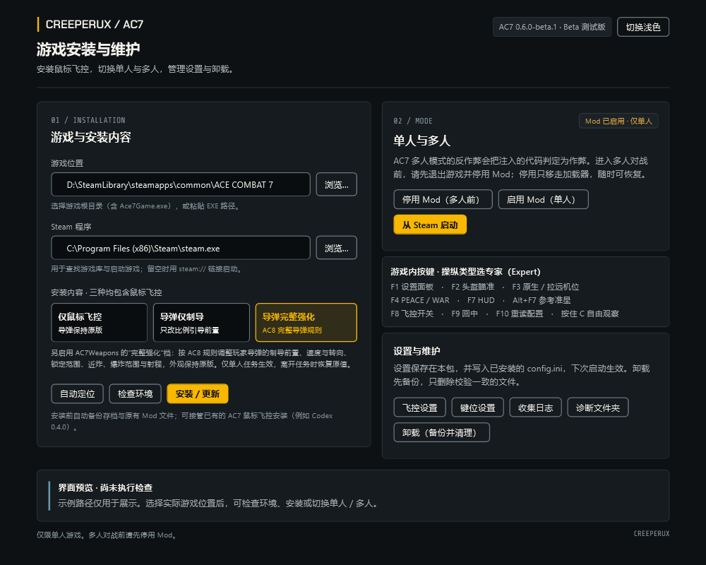

# AC7 Integrated Mod — v0.6.0-beta.1

**Beta 测试版。仅限离线单人，禁止带 Mod 进入线上或多人模式。** AC7 多人模式的反作弊会把注入的代码判定为作弊；联机前请先在启动器里点击「停用 Mod」。

把 [AC8 Integrated Mod](https://github.com/CreeperUX/AC8-Integrated-Mod) 2.4.2 的鼠标飞控移植到 ACE COMBAT 7: SKIES UNKNOWN（Steam，Build 9855922）。鼠标指定方向，Mod 协调飞机姿态飞向圆环。按 **F4** 在两种飞控之间切换：

- **WAR**（默认）：基于还原的 AC7 飞行引擎做精确预测，决策结构参考 War Thunder 鼠标教官；机头走直线，鼠标停下后平滑改平，按住方向键约 0.1–0.2 s 即可接管；
- **PEACE**：经典飞控。

还包括：

- 由 GPU 在原生分辨率独立绘制的准星（鼠标圆环、机头参考准星、头盔瞄准括号环），4K 下同样清晰，线宽可调；
- 按住 C 自由观察、右键放大，F2 头盔瞄准，F3 原生／拉远机位；
- 可选导弹模块 AC7Weapons，两档：**仅制导**（只调整比例引导前置量）和 **完整强化**（AC8 完整导弹规则），只在单人任务中生效；
- 图形化启动器：安装／更新、停用／启用 Mod、飞控与键位设置，安装和卸载前自动备份存档。

## 安装

1. 从 [Releases](https://github.com/CreeperUX/AC7-Integrated-Mod/releases/tag/v0.6.0-beta.1) 下载 **AC7-Integrated-v0.6.0-beta.1.zip**（不要下载 Source code）。
2. 解压到游戏目录之外的新文件夹，关闭游戏，运行 **Start-GUI.cmd**。
3. 选择安装内容，点击「安装／更新」，然后照常从 Steam 启动游戏。游戏内操纵类型选 **专家（Expert）**。

详细说明见压缩包内的 `开始使用.md`。

## 游戏内按键

F1 设置面板 · F2 头盔瞄准 · F3 原生／拉远机位 · F4 WAR／PEACE · F7 HUD · Alt+F7 参考准星 · F8 飞控开关 · F9 回中 · F10 重读配置 · 按住 C 自由观察

- [v0.6.0-beta.1 更新说明](docs/RELEASE-v0.6.0-beta.1.md) · [更新日志](CHANGELOG.md)

基于 AC8 Integrated Mod（源自 [FletcherMiya/AC8-Mouse-Aim](https://github.com/FletcherMiya/AC8-Mouse-Aim)）发展，感谢原作者及贡献者。完整署名和许可见 [THIRD_PARTY_NOTICES.md](THIRD_PARTY_NOTICES.md)。本项目为非官方社区作品，与游戏发行商及上游项目无关。

[English](README.en.md)
